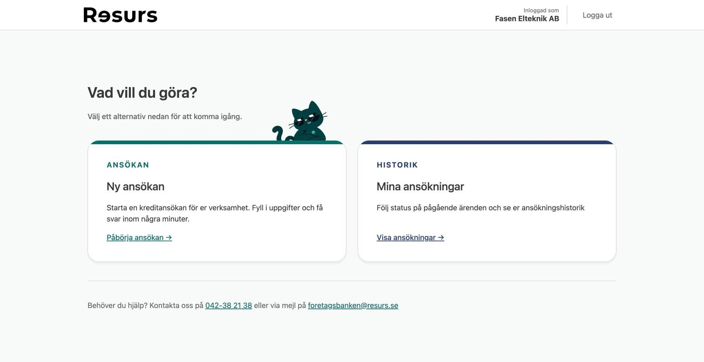
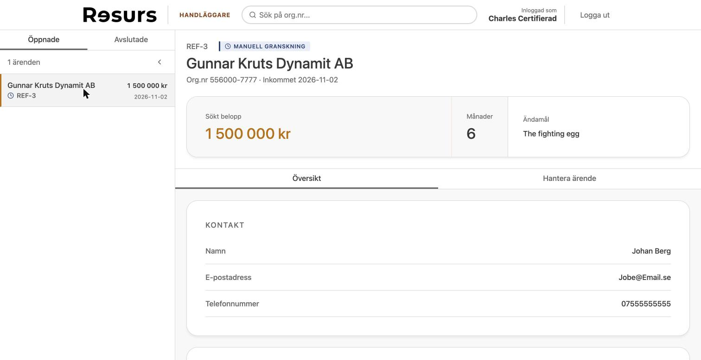

mv# Resurs Kreditportal

### 🏆 #1 – Vinnande bidrag för Resurs Bank

**I samarbete med Resurs Bank, Avanza, SEB, Nordiska och Chas Academy.**

Resurs valde vår lösning som vinnare bland sina team. Nu möter vi finalisterna från Avanza, SEB och Nordiska i finalen.

**[Testa live →](https://resurs-team1-dev.team.chas-challenge.comerit.se)** · [Testinloggningar](#testinloggningar)

<p>
  
  
</p>

Företag ansöker om kredit med BankID och får ett beslut direkt, baserat på finansiella nyckeltal. Handläggare granskar ärenden som kräver manuell bedömning.

- **Enkelt:** vi visar bara det som behövs i varje steg. Att ansöka om kredit, följa sitt ärende eller hantera det som handläggare ska vara lika enkelt som att swisha.
- **Säkert:** krypterade personuppgifter (C/C++ via JNA), signerad audit-logg och rollbaserad åtkomst med stöd för skyddad identitet.
- **Skalbart:** caching, rate limiting och felhantering mot externa register.
- **Moderniserat:** ombyggt från en äldre v1-portal till v2. Se [docs/old documentation/v2-targets.md](docs/old%20documentation/v2-targets.md).

## Slutleverans

| Del | Var |
|-----|-----|
| Installation och körning | [Kom igång](#kom-igång) |
| Testning och teststatus | [Testa](#testa) |
| Beslutslogg | [docs/beslutslogg.md](docs/beslutslogg.md) ([levande version](https://docs.google.com/document/d/1mBkqaqmbPnAC48q2r7RIx__4Ojy2nNBGFFncHj-Lgas/edit)) |
| Kända brister och avgränsningar | [docs/kanda-brister.md](docs/kanda-brister.md) |
| Fallback för demon | [Om demon strular](#om-demon-strular) |
| Så bearbetade vi feedforward | [docs/feedforward.md](docs/feedforward.md) |

## Kom igång

**Krav:** Docker. För frontend-utveckling även Node 22.

### Hela appen
```bash
cd infra && docker compose up --build
```
Öppna [http://localhost:8083](http://localhost:8083). Frontend och backend byggs ihop i Docker.

### Utveckla frontend
Kör Docker enligt ovan, sen i en ny terminal:
```bash
cd frontend
cp .env.example .env   # första gången
npm install            # första gången
npm run dev
```
Öppna [http://localhost:5173](http://localhost:5173). Ändringar syns direkt. Mer i [frontend/README.md](frontend/README.md).

### API-dokumentation
Swagger UI: [http://localhost:8083/swagger-ui/index.html](http://localhost:8083/swagger-ui/index.html)

## Testa

| Del | Kommando | Status                   |
|-----|----------|--------------------------|
| Frontend | `cd frontend && npm test` | ✅ 86/86                  |
| Backend | `cd backend/ResursPortal && mvn test` (kräver Docker för Testcontainers) | ✅ 311/311 Test täckning: 85% (JaCoCo)  |
| Native | `cd native && ./test-linux.sh` (Docker, Ubuntu 24.04 och 22.04) | ✅ 4/4 testsviter på båda |

Native byggs och testas automatiskt i GitHub Actions vid varje PR mot `develop` och `main`, se [docs/native-ci.md](docs/native-ci.md).
Inte testat automatiskt: tillgänglighet (testad manuellt med skärmläsare och tangentbord) och end-to-end-flöden i webbläsaren.

## Om demon strular

1. **Stage nere:** kör appen lokalt enligt [Kom igång](#kom-igång). Seed-datan ger samma testföretag och handläggare.
2. **Den som demonstrerar kan inte fortsätta:** någon annan i teamet tar över.
3. **Inget fungerar live:** vi visar förinspelade delar av demon.

## Miljöer

| Miljö | Adress | Deployas från |
|-------|--------|---------------|
| Stage | https://resurs-team1-dev.team.chas-challenge.comerit.se | `develop` |
| Prod  | https://resurs-team1.team.chas-challenge.comerit.se | `main` |

Allt byggs automatiskt vid push. Se [DRIFT.md](DRIFT.md).

## Testinloggningar

Seed-datan skapas automatiskt första gången appen startar.

### Företag (BankID-mock)

| Företag | Org.nr | Firmatecknare | Personnr | Finanser                                      |
|---------|--------|---------------|----------|-----------------------------------------------|
| Fasen Elteknik AB | `556000-1234` | Anders Karlsson | `750312-1234` | Goda                                          |
| Britt Maries Ögonfransar AB | `556000-5678` | Maria Svensson | `820624-5678` | Negativt rörelseresultat. Hard reject         |
| Gunnar Kruts Dynamit AB | `556000-7777` | Johan Berg | `660930-7777` | Lån över 1 000 000 kr markeras för granskning |
| Frukt och grönt Göteborg | `556000-9999` | Erik Lindqvist | `681105-9999` | Skyddad identitet (saknas underlag)           |

### Handläggare

| E-post | Lösenord | Roll |
|--------|----------|------|
| `karin@resurs.se` | `password123` | Handläggare |
| `charles@resurs.se` | `password456` | Certifierad (ser skyddade uppgifter) |
| `anders@resurs.se` | `password789` | Admin |

## Teknik

| Del | Teknik |
|-----|--------|
| Frontend | React 19, TypeScript, Vite |
| Backend | Java 21, Spring Boot 4, Spring Security, JPA |
| Databas | PostgreSQL 16 |
| Native | C/C++ via JNA (PII-kryptering, audit-signering) |

## Mappstruktur

```
frontend/                  ← React-appen (se frontend/README.md)

backend/ResursPortal/      ← Spring Boot (Maven)
  src/main/java/se/comerit/resurs/
    controller/            ← REST-endpoints
    service/               ← affärslogik (scoring, ansökningar, audit …)
    persistence/           ← JPA-entiteter och repositories
    security/              ← inloggning och behörighet
    client/                ← mockade externa tjänster (BankID, företagsregister, SPAR)
    jna/                   ← koppling till native-biblioteken
    seed/                  ← testdata

infra/                     ← docker-compose och databasschema
native/                    ← C/C++-moduler för kryptering och audit
docs/                      ← slutleverans, native-guider, v1-underlag
```

## Teamet

| Område | Namn |
|--------|------|
| Frontend (React) | [David Lindblom](https://github.com/Gagipose), [Veronica Czarnotta](https://github.com/vczarnotta) |
| Backend (Java) | [Jonathan Söderlund](https://github.com/Joso1207), [Lukas Alexandersson](https://github.com/alexandersson98), [Robin Lindholm](https://github.com/BobbyBrogrammer) |
| Native (C/C++) | [Axel Lindström](https://github.com/Hbitz), [Elias Kesebol](https://github.com/keseboleliasteliacom) |
