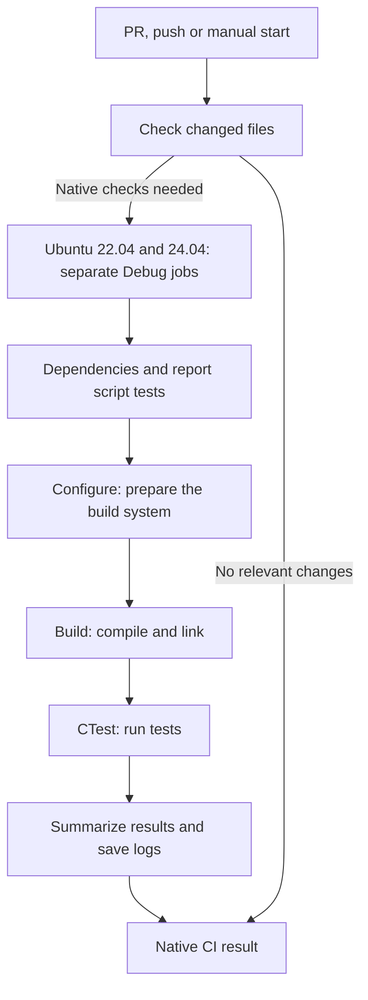

# Developer guide: native builds and tests

This guide explains how the native modules are configured, built and tested,
what the automated checks verify, and how to troubleshoot or extend the
workflow. It describes the project's current CMake configuration and CI workflow.

For a summary of the native modules and their Java integration guides, start
with the [Native overview](../native/README.md).

## Find the right documentation

| Document | Purpose |
|---|---|
| [Native overview](../native/README.md) | Entry point for encryption, audit and their Java integration guides. |
| This guide | Understand the build stages, test coverage and workflow maintenance. |
| [Native CI](native-ci.md) | Details about GitHub runs, change detection, reports and merge protection. |
| [Native with Docker](../native/DOCKER.md) | Build and test locally with Docker, run demos and enable audit sanitizers. |
| [Crypto](../native/resurs_crypto/README.md) and [Audit](../native/resurs_audit/README.md) | Module behavior and native interfaces. |
| [Crypto/JNA](../native/resurs_crypto/JNA_INTEGRATION.md) and [Audit/JNA](../native/resurs_audit/JNA_INTEGRATION.md) | Calls from Java, data types, buffers and result codes. |
| [Operations and deployment](../DRIFT.md) | The platform's operating instructions and deployment rules. |

The following documents belong to the original case material and its target design:

- [Architecture v1](old%20documentation/architecture.md)
- [Known issues v1](old%20documentation/known-bugs.md)
- [Pain points v1](old%20documentation/README-pain-points.md)
- [Refactoring targets v2](old%20documentation/v2-targets.md)
- [Original native README](old%20native%20documentation/README.md)

Case descriptions and targets are not a verified description of the current
implementation or remaining defects. They are preserved in `old documentation/`
and `old native documentation/`. Requirements and platform instructions still
apply within their respective areas.

## The GitHub Actions workflow

The workflow is defined in [native-ci.yml](../.github/workflows/native-ci.yml).
It runs for pull requests targeting `develop` and `main`, pushes to those
branches, and manual starts in GitHub Actions.



Change detection watches `native/`, the workflow file, the report script and its
tests, plus `.gitattributes` and `.gitmodules`. Manual runs always build. If the
comparison cannot be made, the workflow builds rather than skipping the checks.
Changes only in `docs/` do not trigger native builds; documentation changes under
`native/` do.

Each Ubuntu job runs these steps in order:

| Stage | What happens and what is checked |
|---|---|
| Dependencies | Installs `build-essential`, `cmake` and `libssl-dev`. |
| Report script tests | Runs Python tests for the CTest result summary, including failures, missing reports and inconsistent counts. |
| Environment log | Records the Ubuntu, CMake, compiler and OpenSSL development package versions for troubleshooting. |
| Configure | Checks CMake and compiler prerequisites, finds OpenSSL and generates the build system with the selected settings. No test code runs here. |
| Build | Compiles and links both shared libraries, both demo programs and all test executables in the default build. |
| Test | CTest runs every registered test executable. Failures, timeouts or no registered tests cause the step to fail. |
| Report and logs | Always attempts to write the summary and save available logs, including after an earlier failure. |

The demo programs are built to catch build errors in the examples. They are not
run as tests in CI. A failure in an earlier step normally causes later build and
test steps to be skipped.

The two Ubuntu jobs run independently; a failure in one does not cancel the other.
`Native CI result` passes when change detection succeeds and either both Ubuntu
jobs succeed or no native builds were needed. Read the summary to see whether
tests actually ran.

## Build settings

[native/CMakeLists.txt](../native/CMakeLists.txt) defines the libraries,
dependencies, demos and CTest registrations. The project requires CMake 3.20 or
later, C++17 and OpenSSL 3.x development files. The source uses OpenSSL 3 APIs;
`find_package(OpenSSL REQUIRED)` currently does not enforce that minimum version,
so finding an older OpenSSL package is not enough to build the project. The CI
command's JUnit reporting requires CMake 3.21 or later.

| Setting | Value in Native CI | Meaning |
|---|---|---|
| `CMAKE_BUILD_TYPE` | `Debug` | Selects the Debug configuration for the single-configuration Linux build. |
| `BUILD_TESTING` | `ON` | Builds and registers the test executables. |
| `RESURS_BUILD_CRYPTO_DEMO` | `ON` | Includes the crypto demo in the build. |
| `RESURS_BUILD_AUDIT_DEMO` | `ON` | Includes the audit demo in the build. |
| `RESURS_AUDIT_ENABLE_SANITIZERS` | `OFF` by default | Optional AddressSanitizer and UndefinedBehaviorSanitizer checks for audit targets; requires GCC or Clang. |

The libraries link against OpenSSL Crypto. CMake enables compiler warnings with
`-Wall -Wextra -Wpedantic`, or `/W4` with MSVC, for the libraries and test
executables. Warnings are not generally treated as errors, so a passing build
does not mean the compiler reported no warnings.

The audit test harness replaces standard `assert` with always-active checks,
so its checks and native calls run in both Debug and Release. Native CI runs
Debug; Release is a separate distribution-build check. With Visual Studio's
multi-configuration generator, select the configuration using `--config` when
building and `-C` when running CTest, as shown below.

## What the tests check

CTest currently registers four test executables. Each contains multiple named
tests or checks.

| Test executable and source | Examples of coverage |
|---|---|
| [resurs_crypto_tests](../native/tests/resurs_crypto_tests.cpp) | AES-256-GCM encryption and decryption, a known test vector, different data lengths, IV handling, tampered ciphertext/IV/tag, wrong keys, invalid pointers and lengths, and buffer boundaries. |
| [resurs_audit_tests](../native/tests/resurs_audit_tests.cpp) | Key generation and validation, deterministic hashing, signing and verification, known hash and signature values, modified entries, chain links and sequence numbers, removed or reordered entries, wrong keys, failure indexes, binary and large inputs, and native structure sizes and field offsets for the JNA contract. |
| [resurs_crypto_symbol_tests](../native/tests/resurs_crypto_symbol_tests.cpp) | Loads the newly built library and looks up `aes_256_gcm_encrypt` and `aes_256_gcm_decrypt`. |
| [resurs_audit_symbol_tests](../native/tests/resurs_audit_symbol_tests.cpp) | Loads the newly built library and looks up `generate_private_key`, `get_public_key`, `wrapper_hash_and_sign` and `wrapper_verify_chain`. |

The symbol tests check that functions can be found by their expected names. They
do not run a JVM or verify the types and memory handling in Java declarations.
The audit tests check structure layout on the native side. Symbol tests require
the listed exports to exist; they do not reject additional exported symbols.

The audit suite also checks a limitation: a valid prefix of a chain can still
verify after the tail has been removed. Detecting this requires the application
to have a trusted expected final value or count outside the chain supplied to
the verifier. See the [Audit/JNA guide](../native/resurs_audit/JNA_INTEGRATION.md).

The report script [native_ci_report.py](../.github/scripts/native_ci_report.py)
reads CTest's JUnit XML and the executables' `[PASS]`/`[FAIL]` lines. Counts refer
to named tests, test groups or symbol checks, not individual assertions or
iterations. Missing individual counts are shown as missing rather than inferred.
A missing, unreadable or empty CTest report, reported failures and skipped test
modules are not accepted as passing by the report script.

## What a passing result covers

When the native jobs have run, the result shows that the checked-out source code
builds and passes the registered tests on Ubuntu 22.04 and 24.04 in Debug mode.
For pull requests, GitHub's proposed merge with the target branch is built.

Native CI does not cover:

- Java/JNA calls, JAR resources or the backend's library packaging.
- Backend and frontend tests or complete application user flows.
- Windows builds, Windows DLLs, Release builds or sanitizer runs.
- Building the native Dockerfile or verifying its image.
- Checking or updating existing prebuilt files in the repository.
- Publishing libraries, Docker images or deployments.

Java/JNA integration therefore needs separate verification even when native
checks pass. CI builds the libraries from source and loads the newly built Linux
libraries in the symbol tests.

Merge protection is configured separately in GitHub. The workflow file does not
create those rules. According to the [operations guide](../DRIFT.md), deployment
starts on pushes to `develop` and `main`; a subsequent CI run does not stop a
deployment that has already been triggered. See [Native CI](native-ci.md) for
details about the status check.

## Run locally

Run these commands from the repository root. On Ubuntu, the commands below
require `build-essential`, `libssl-dev` and CMake 3.21 or later:

```bash
cmake -S native -B build/native-ci -DCMAKE_BUILD_TYPE=Debug -DBUILD_TESTING=ON -DRESURS_BUILD_CRYPTO_DEMO=ON -DRESURS_BUILD_AUDIT_DEMO=ON
cmake --build build/native-ci --parallel 2
ctest --test-dir build/native-ci --verbose --output-on-failure --no-tests=error --timeout 120 --test-output-size-passed 1048576 --test-output-size-failed 1048576 --output-junit "$PWD/build/native-ci/ctest.xml"
```

List the test executables registered with CTest:

```bash
ctest --test-dir build/native-ci --show-only
```

Run only the audit behavior tests, including output from successful checks:

```bash
ctest --test-dir build/native-ci --tests-regex '^resurs_audit_tests$' --verbose --output-on-failure --no-tests=error --timeout 120
```

Rebuild after code changes before running CTest again. CTest does not build the
code. The command above selects an entire test executable, not an individual
named test inside it.

The report script's tests can be run separately with Python 3:

```bash
python3 -m unittest discover -s .github/scripts -p 'test_native_ci_report.py'
```

On Windows, use Docker Desktop and run the following from Git Bash or WSL with
Docker available:

```bash
bash native/test-linux.sh
```

The script builds and tests both Ubuntu versions without Docker's build cache
and reports failure if either version fails. It tests Linux builds even when
the host runs Windows. For PowerShell commands, individual Docker builds,
demos and optional audit sanitizers, see the [Docker guide](../native/DOCKER.md).

### Windows with Visual Studio

Use an x64 Visual Studio C++ toolchain, CMake and vcpkg with OpenSSL 3.x. Run
from the repository root. Replace the vcpkg path with your installation and
select an installed Visual Studio generator listed by `cmake --help`; this
example uses Visual Studio 18 2026:

```powershell
cmake -S native -B build/native-windows -G "Visual Studio 18 2026" -A x64 "-DCMAKE_TOOLCHAIN_FILE=C:/path/to/vcpkg/scripts/buildsystems/vcpkg.cmake" -DVCPKG_TARGET_TRIPLET=x64-windows-static -DBUILD_TESTING=ON -DRESURS_BUILD_CRYPTO_DEMO=ON -DRESURS_BUILD_AUDIT_DEMO=ON
cmake --build build/native-windows --config Debug --parallel 2
ctest --test-dir build/native-windows -C Debug --output-on-failure --no-tests=error --timeout 120
```

`CMAKE_BUILD_TYPE` does not select a configuration for this generator. To verify
a Release build, build with `--config Release` and run CTest with `-C Release`.
The DLLs are placed under the build directory's `Debug/` or `Release/` folder.

The `x64-windows-static` triplet links OpenSSL statically. The distributed
Windows DLLs still depend on the x64 MSVC runtime and Windows system libraries.
A build using dynamic OpenSSL also needs matching OpenSSL runtime DLLs. Inspect
the dependencies of the actual file with `dumpbin /dependents`.

## Troubleshoot a failed run

Open the workflow run and start with the first failed step in the affected Ubuntu
job. Later skipped steps and a missing test report may be consequences of the
first failure.

| Failed step | Start here |
|---|---|
| `Detect native changes` | Read the job log for checkout and revision comparison errors. The overall result cannot pass through the normal workflow if this job fails. |
| `Install build dependencies` | Read the installation log for package, network or runner errors. |
| `Check report generation` | Read the Python test failure and review the report script together with its tests. |
| `Configure native libraries, demos and tests` | Read `logs/configure.log`: check the CMake version, compiler, OpenSSL and configured paths. |
| `Compile all native targets` | Read `logs/build.log`: start with the first compilation or linker error. |
| `Run all registered native tests` | Expand the test module in the summary and read `logs/tests.log`. Rerun the corresponding CTest executable locally. For library loading failures, also check dependencies and exported functions. |
| `Write test summary` | Check earlier steps and `ctest.xml`. Missing XML after a build failure is a consequence; malformed XML or inconsistent test counts need separate investigation. |
| `Native CI result` | Check change detection and both Ubuntu jobs, even if one of them succeeded. |

The summary is available directly in the GitHub run. Available reports and logs
are retained for seven days as `native-ubuntu-22.04-debug` and
`native-ubuntu-24.04-debug`. Paths in the table are relative to
`build/native-ci/`, which also contains `ctest.xml` and CTest logs under
`Testing/Temporary/`. Each Ubuntu job has a 15-minute time limit, and each
registered CTest executable has a 120-second timeout.

## Add and maintain tests

1. Add new test cases to the appropriate file under `native/tests/` and register
   them in the executable's existing test list or `run_test` calls. A new function
   does not run automatically just because it exists in the file.
2. If you create a new test executable, add it under `if(BUILD_TESTING)` in
   [CMakeLists.txt](../native/CMakeLists.txt), link the appropriate libraries and
   register it with `add_test`. CI builds the default targets and runs every CTest
   registration; the workflow file normally needs no change for a new executable.
3. Preserve the output format for individual results and final totals. Return a
   non-zero exit code if any check fails. For example:

   ```text
   [PASS] valid input
   [FAIL] invalid key: expected rejection
   1/2 tests passed
   ```

   The report script also supports totals ending in `test groups passed` or
   `symbol checks passed`. If the format changes, update both the
   [report script](../.github/scripts/native_ci_report.py) and
   [its tests](../.github/scripts/test_native_ci_report.py).
4. Add new test executables to the explicit `--target` list in
   [native/Dockerfile](../native/Dockerfile) so the Docker workflow also builds
   them before CTest runs. CI uses the default build without this target list.
5. Run configure and build again, check registrations with `ctest --show-only`
   and run the tests. Use Debug for the normal CI-equivalent pass and Release
   when verifying distribution builds. Audit requirements remain active in both.

When public functions change, review the corresponding symbol test and Java/JNA
contract as well. When build settings, environments or report formats change,
update this guide, [Native CI](native-ci.md) and the affected build instructions
in the same change. Describe the resulting behavior so the guide can be read
without knowing the history of earlier refactorings.
